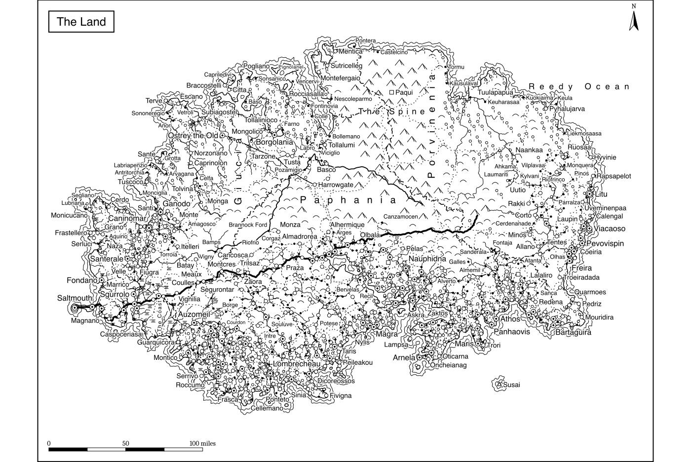
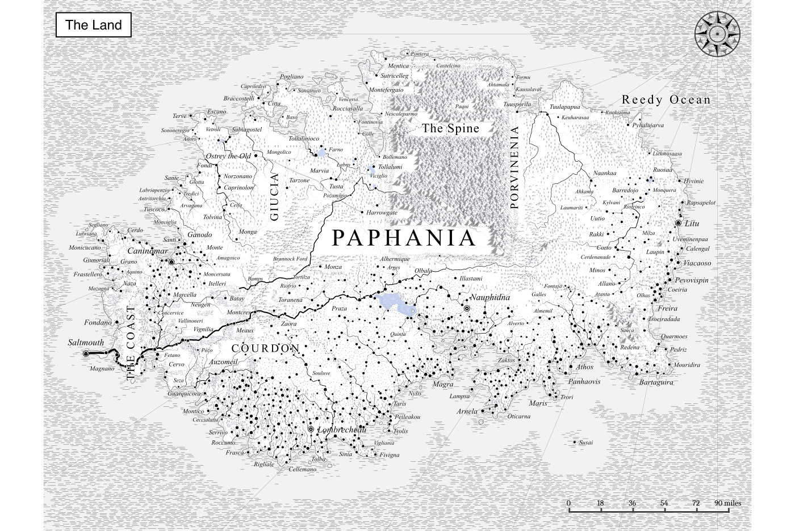
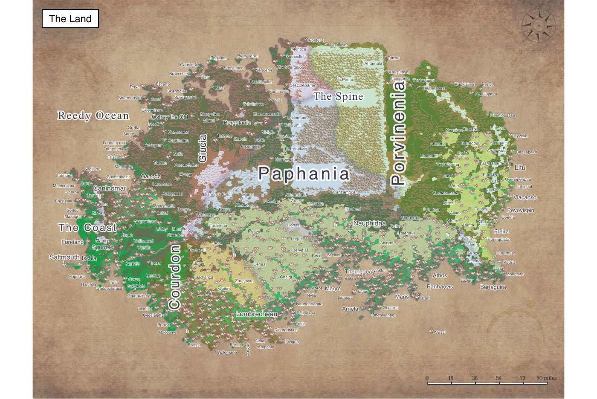
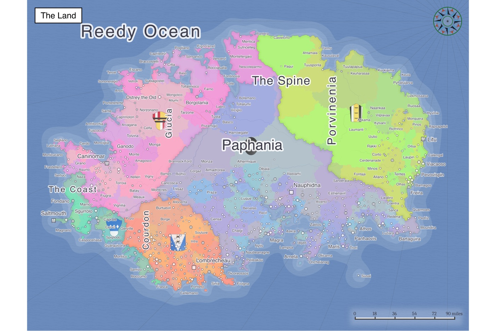
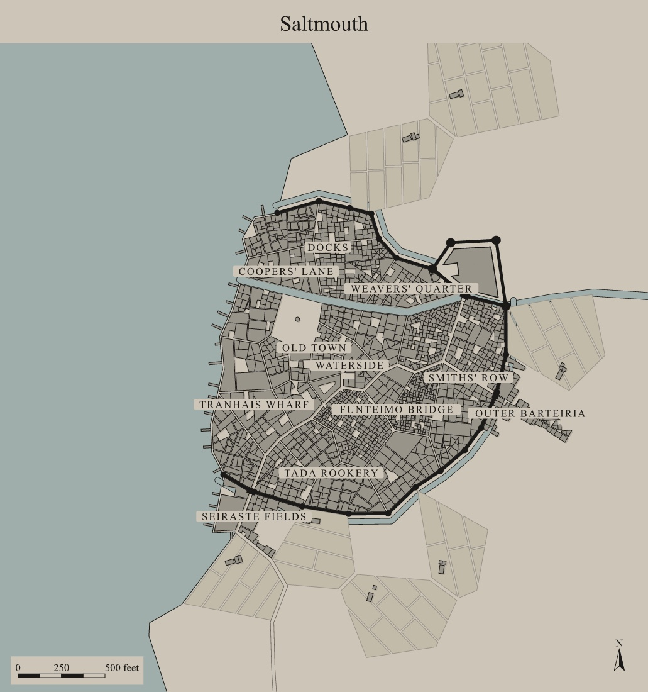
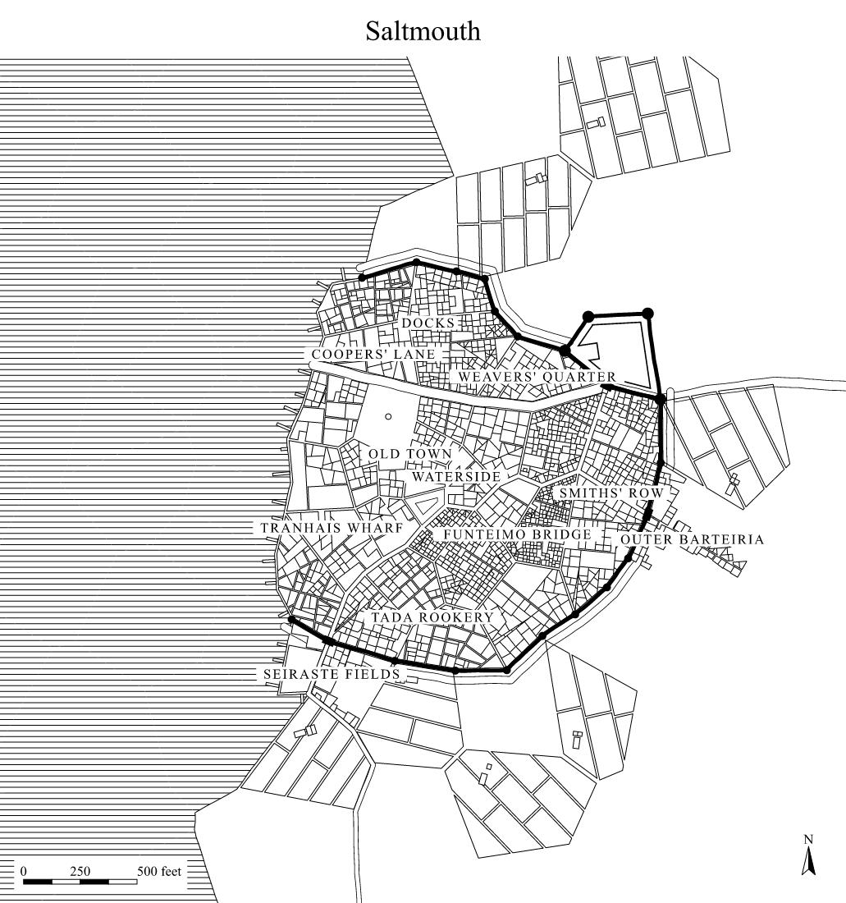
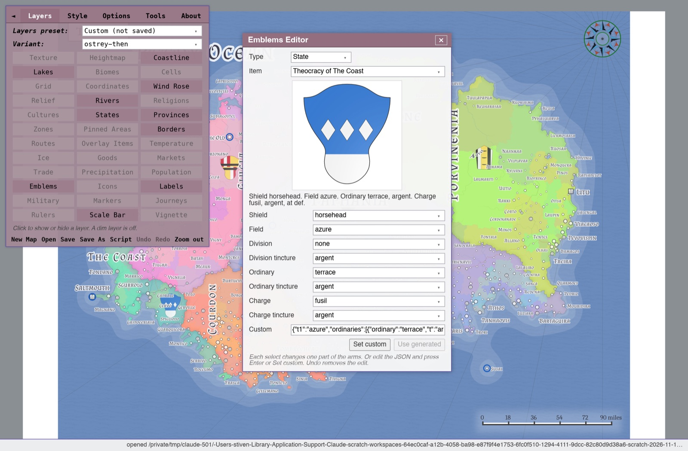

<div align="center">


### A fantasy map engine in Rust, for maps that a book can cite

_A faithful remake of Azgaar's Fantasy Map Generator, with hard pins, print-safe SVG, and a command line for agents._


[](#licence)
[](https://github.com/Stiven-Gjekaj/inkland/releases/latest)

<p align="center">
  <a href="#overview"><b>Overview</b></a> |
  <a href="#gallery"><b>Gallery</b></a> |
  <a href="#speed"><b>Speed</b></a> |
  <a href="#install"><b>Install</b></a> |
  <a href="#use"><b>Use</b></a> |
  <a href="#the-desktop-app"><b>App</b></a> |
  <a href="#documentation"><b>Docs</b></a>
</p>

</div>

---

> [!NOTE]
> **Version 1.0 ports all of Azgaar's Fantasy Map Generator.**
> Each generation stage runs as in FMG: terrain, climate, water, biomes,
> cultures, burgs, states, provinces, routes, religions, coats of arms,
> diplomacy, the economy, the military, markers, zones, and journeys.
> Colour mode draws each FMG layer with the 15 style presets.
> [docs/PORT.md](docs/PORT.md) compares each stage with FMG, and says what
> is not ported yet.
> Version 1.1 adds the desktop app to the release packages. Its data
> dialogs add markets, regiments, zones, journeys, measurers, and legend
> boxes on the map.
> Version 1.2 gives the maps a more organic, hand-drawn look: rough coasts
> and region outlines, mountain chains, ocean depth bands, curved labels and
> roads, and terrain character areas. [docs/notes/book-maps.md](docs/notes/book-maps.md)
> gives the options for book maps.

---

## Overview

**inkland** makes fantasy maps from a JSON config.
The same seed and config give the same bytes on each machine.

FMG makes beautiful maps in a browser, but a map in a book has other
needs. A chapter cites the map: "the road from Kingsholm to Harbour is 71
miles". The city must stay where the story put it. The page must print in
black and white. And a script or an agent must be able to check each
fact.

inkland keeps the generator of FMG and adds these things.
You pin the places, regions, rivers, and roads that the story needs.
The engine fits the world around the pins, and never moves them.

<table>
<tr>
<td width="50%" valign="top">

### What it does

- **Generates the full FMG world**: heightmaps, lakes, rivers, biomes,
  cultures, burgs, states, provinces, routes, religions, arms, economy,
  military, markers, zones, and journeys.
- **Keeps your pins.** A place stays at its exact point. A river passes
  its points in order. A road can have a target length.
- **Draws two kinds of map.** Print-safe SVG in black and white, or the
  colour layers of the 15 FMG style presets.
- **Places labels without overlap**, and reports each label that has no
  free place.
- **Makes variants of one world**: crops, page sizes, and overlays for
  another age.
- **Takes the edits of the FMG editors as config**, so an edit comes back
  after each regeneration.
- **Draws the town map of a place**, offline: walls, gates, wards, streets,
  and buildings, from a port of TownGeneratorOS by Watabou
  (`inkland town`). inkland adds lots along the streets, the sea and the
  river of the place, bridges, piers, named districts, fields, a scale
  bar, a compass, a moat, varied building shapes, and pinned buildings
  from the config.

</td>
<td width="50%" valign="top">

### How it behaves

- The same bytes on Linux, macOS, and Windows. CI checks golden hashes.
- `--dry-run` checks the config and the pins before generation.
- JSON on stdout, no prompts, and a stable error code for each failure.
- Each edit has an exact undo.
- The print checks run on each SVG: line widths, fonts, and black and
  white only.
- Up to 8 times faster than FMG: a 100 000-cell world takes 0.45 s with
  all stages. [Speed](#speed) gives the measures.
- `docs/CONFIG.md` comes from the JSON Schema of the config.

</td>
</tr>
</table>

---

## Gallery

<table>
<tr>
<td width="50%" valign="top">

**Print-safe**, for a book page



</td>
<td width="50%" valign="top">

**The `ink` style**, with height hachures and lake ripples



</td>
</tr>
<tr>
<td width="50%" valign="top">

**The `ancient` style**, with the paper texture and relief icons



</td>
<td width="50%" valign="top">

**The `default` style**: states, provinces, and coats of arms



</td>
</tr>
</table>

<table>
<tr>
<td width="50%" valign="top">

**A town map in colour**: the port of Saltmouth, with its docks, river,
moat, castle, and districts



</td>
<td width="50%" valign="top">

**The same town, print-safe**, with lines on the sea



</td>
</tr>
</table>

The six maps come from one config: `fixtures/configs/full.json`.

---

## Speed

inkland generates a world **5 to 8 times faster** than FMG. The gap grows
with the cell count. The render of one colour map is a little faster than
in FMG.

**Generation**: all stages, from the heightmap to the journeys

```text
10K cells   FMG      ███▊                                       342 ms
            inkland  ▊                                           70 ms   4.9x faster

20K cells   FMG      ███████▉                                   733 ms
            inkland  █▎                                         120 ms   6.1x faster

50K cells   FMG      ████████████████████▏                     1870 ms
            inkland  ██▋                                        247 ms   7.6x faster

100K cells  FMG      ████████████████████████████████████████  3708 ms
            inkland  ████▉                                      452 ms   8.2x faster
```

**Render**: the layers of one colour map

```text
10K cells   FMG      ██████████████████▊                         60 ms
            inkland  ███████████████▋                            50 ms   1.2x faster

20K cells   FMG      ████████████████████████▍                   78 ms
            inkland  ███████████████████                         61 ms   1.3x faster

50K cells   FMG      ███████████████████████████████▎           100 ms
            inkland  █████████████████████████▎                  81 ms   1.2x faster

100K cells  FMG      ████████████████████████████████████████   128 ms
            inkland  ██████████████████████████████████████▏    122 ms   1.0x faster
```

| Cells | FMG generate | inkland generate | Faster | FMG render | inkland render | Faster |
|---:|---:|---:|---:|---:|---:|---:|
| 10 000 | 342 ms | **70 ms** | 4.9x | 60 ms | **50 ms** | 1.2x |
| 20 000 | 733 ms | **120 ms** | 6.1x | 78 ms | **61 ms** | 1.3x |
| 50 000 | 1870 ms | **247 ms** | 7.6x | 100 ms | **81 ms** | 1.2x |
| 100 000 | 3708 ms | **452 ms** | 8.2x | 128 ms | **122 ms** | 1.0x |

<details>
<summary><b>How we measured</b></summary>

- One machine: Apple M5, 16 GB, macOS 27.2. inkland and Chrome did not
  run at the same time.
- FMG 1.158.0 from azgaar.github.io, in headless Chrome 157, at
  1024 x 681 pixels. The times are the "Generation Pipeline" and "Layers
  Rendering" measures that FMG records. Two runs of
  `scripts/bench-fmg.sh` made 12 maps for each cell count, with random
  seeds and templates, after 1 map to warm up.
- inkland 1.1.0, release build, one thread. The times are `World::build`
  and the SVG of one colour variant in the `default` style. Each cell
  count makes 6 maps: the seeds 1 to 6 with 6 FMG templates.
  `cargo run --release -p inkland --example timing` runs this test.
- Each number is a median.
- After the regraph step, the maps have about the same number of cells.
  At 100 000 cells the median is 48 200 in FMG and 45 100 in inkland.
- The render of FMG counts only the build of the SVG elements. The browser
  draws them after this, and that time is not in the table. The render of
  inkland makes the full SVG text.

</details>

---

## Install

Download the package for your host from the
[latest release](https://github.com/Stiven-Gjekaj/inkland/releases/latest).
`SHA256SUMS.txt` holds the checksum of each package.

| Package | What it holds |
|---|---|
| `inkland-<version>-<target>` | The `inkland` command line tool, the licences, and the reference documents |
| `inkland-app-<version>-<target>` | The `inkland-app` desktop app, the licences, and `docs/APP.md` |

The Linux package of the command line tool is one static binary with no
runtime dependencies. The Linux app needs the system libraries of a
desktop: fontconfig, freetype, xkbcommon, and X11 or Wayland.
The app binaries are not signed. On macOS, remove the quarantine flag
with `xattr -d com.apple.quarantine inkland-app` before the first start.

To build from source, use Rust 1.100:

```bash
cargo install --path crates/inkland-cli
```

The desktop app builds from the same workspace:

```bash
cargo run --release -p inkland-app
```

---

## Use

Generate a world, its maps, and a PNG preview:

```bash
inkland generate --config map.json --out-dir out --preview out/map.png
```

Check the config and the pins, and generate nothing:

```bash
inkland generate --config map.json --dry-run
```

Ask for the facts at a point, and export GeoJSON:

```bash
inkland query --world out/world.json --at 120.5,88
```

```bash
inkland export --world out/world.json --format geojson > map.geojson
```

Apply an edit script, and get its undo script:

```bash
inkland edit --world out/world.json --script edits.json -o out/world.json
```

Import a map of FMG, and check any SVG for print:

```bash
inkland import --map fixtures/azgaar/1.154.0.map.gz -o imported.json
```

```bash
inkland check --svg out/map.svg
```

`generate` writes `world.json`, and for each variant `<variant>.svg` and
`<variant>.report.json`. The report gives each pin and where it is, each
road length, each label that has no place, and the print checks. A failed
check gives exit code 1.

A small config:

```json
{
  "version": 1,
  "seed": 42,
  "units": { "name": "mile" },
  "frame": { "width": 400, "height": 300 },
  "world": { "cells": 20000, "template": "continents" },
  "pins": {
    "points": [
      { "id": "kingsholm", "kind": "city", "name": "Kingsholm", "at": [120, 88], "capital_of": "The Kingdom" },
      { "id": "harbour", "kind": "town", "name": "Harbour", "at": [40, 150], "port": true }
    ],
    "regions": [{ "id": "western-sea", "kind": "sea", "name": "The Western Sea", "box": [0, 0, 20, 300] }],
    "roads": [{ "id": "kings-road", "from": "kingsholm", "to": "harbour", "target_length": 120 }]
  },
  "render": { "mode": "colour", "style": "ancient" },
  "variants": [{ "name": "full", "page": { "w_mm": 250, "h_mm": 167, "margin_mm": 5 } }]
}
```

---

## The desktop app



`inkland-app` is a desktop editor in the layout of FMG: the Layers, Style,
Options, Tools, and About tabs, and the FMG editors as dialogs. Each edit
is a command on the config, with undo and redo, and the app saves the
edits as a script. [docs/APP.md](docs/APP.md) describes it.

---

## Documentation

| Document | What it holds |
|---|---|
| [docs/CLI.md](docs/CLI.md) | Each command and flag |
| [docs/CONFIG.md](docs/CONFIG.md) | The config, made from the JSON Schema |
| [docs/ERRORS.md](docs/ERRORS.md) | Each error code and exit code |
| [docs/STYLES.md](docs/STYLES.md) | The style tree of the colour presets |
| [docs/TERRAIN.md](docs/TERRAIN.md) | How to draw the land and the sea of a book map |
| [docs/PORT.md](docs/PORT.md) | Each FMG stage and editor, and its place in inkland |
| [docs/notes/](docs/notes/) | The details of each part, and what differs from FMG |
| [docs/APP.md](docs/APP.md) | The desktop app |
| [docs/SPEC.md](docs/SPEC.md), [docs/PLAN.md](docs/PLAN.md) | The specification, and the plan with its milestone notes |
| [docs/DECISIONS.md](docs/DECISIONS.md) | The decisions and their reasons |

---

## Credits

inkland is a remake of
[Azgaar's Fantasy Map Generator](https://github.com/Azgaar/Fantasy-Map-Generator)
by Max Haniyeu (Azgaar), under the MIT licence. inkland writes the
algorithms again in Rust. It takes the data tables, the style presets, and
the art of FMG, with their licences.
[THIRD_PARTY_NOTICES.md](THIRD_PARTY_NOTICES.md) lists each one.

The town maps come from a port of
[TownGeneratorOS](https://github.com/watabou/TownGeneratorOS) by Watabou,
under the GPL-3.0. Each place also links to the Medieval Fantasy City
Generator of Watabou, as in FMG.

The desktop app uses [Slint](https://slint.dev) under the GPL-3.0.

## Licence

inkland is licensed under the GNU General Public License, version 3 or any
later version ([LICENSE](LICENSE)). The town maps come from a port of
[TownGeneratorOS](https://github.com/watabou/TownGeneratorOS) by Watabou,
which is GPL-3.0. The releases up to v1.3.3 are MIT OR Apache-2.0.
