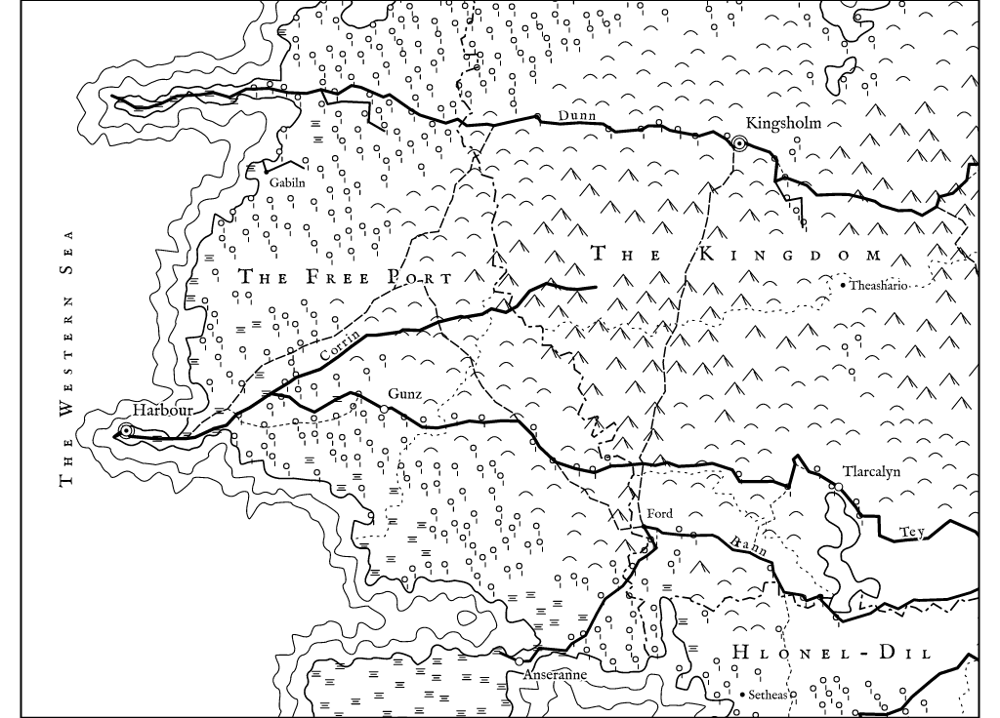

# inkland

inkland is a deterministic fantasy map engine in Rust. It makes print-ready
black-and-white SVG maps from a JSON config. You pin places, regions,
rivers, and roads. The engine fits the world around the pins and never
moves them. The same seed and config give the same bytes on each machine.

The main use is the maps of a D&D book. A chapter can cite a fact from a
map, for example "the road from Kingsholm to Harbour is 71 miles", and a
machine can check that fact.



## What it does

- Terrain from heightmap templates, a raster, or brush strokes. Climate,
  biomes, lakes, rivers, cultures, places, states, provinces, religions,
  roads, and names for rivers, islands, and lakes.
- Pins: a place stays at its exact position, on land. A region gets heights
  in its range. A river passes its points in order, flows downhill, and
  ends at its mouth. A road can have a target length and a tolerance.
- Print-safe SVG: black and white only, line widths of 0.5 pt or more, real
  `<text>` with the fonts that you name, water lines and relief symbols,
  stable element ids, a scale bar, a compass, a cartouche, and a grid.
- Labels without overlap. A label that has no free place goes in the
  report, never on top of another label.
- Variants of one world: crops, page sizes, and overlays ("the kingdom in
  the first age") that add, remove, or rename items. An overlay never
  changes the terrain, so `world.json` stays the same.
- Agent-friendly command line: JSON in, JSON out, stable error codes, no
  questions. `query` gives the facts at a point. `export` gives GeoJSON.
  `edit` applies undoable edit scripts.
- Import of maps from Azgaar's Fantasy Map Generator.

## Install

A version tag builds packages for Linux, macOS, and Windows and puts them on
the [releases](https://github.com/Stiven-Gjekaj/inkland/releases) page. To
build from source, use Rust 1.100:

```bash
cargo install --path crates/inkland-cli
```

The Linux package is one static binary with no runtime dependencies.

## Use

```bash
inkland generate --config map.json --out-dir out --preview out/map.png
```

```bash
inkland generate --config map.json --dry-run
```

```bash
inkland query --world out/world.json --at 120.5,88
```

```bash
inkland export --world out/world.json --format geojson > map.geojson
```

```bash
inkland edit --world out/world.json --script edits.json -o out/world.json
```

```bash
inkland import --map fixtures/azgaar/1.154.0.map.gz -o imported.json
```

```bash
inkland check --svg out/map.svg
```

`generate` writes `world.json`, and for each variant `<variant>.svg` and
`<variant>.report.json`. The report gives each pin and where it is, each
road length, each label that has no place, and the print checks. A failed
check gives exit code 1.

A small config:

```json
{
  "version": 1,
  "seed": 42,
  "units": { "name": "mile" },
  "frame": { "width": 400, "height": 300 },
  "world": { "cells": 20000, "template": "continents" },
  "pins": {
    "points": [
      { "id": "kingsholm", "kind": "city", "name": "Kingsholm", "at": [120, 88], "capital_of": "The Kingdom" },
      { "id": "harbour", "kind": "town", "name": "Harbour", "at": [40, 150], "port": true }
    ],
    "regions": [{ "id": "western-sea", "kind": "sea", "name": "The Western Sea", "box": [0, 0, 20, 300] }],
    "roads": [{ "id": "kings-road", "from": "kingsholm", "to": "harbour", "target_length": 120 }]
  },
  "variants": [{ "name": "full", "page": { "w_mm": 167, "h_mm": 250, "margin_mm": 5 } }]
}
```

## Documentation

- [Command line reference](docs/CLI.md)
- [Config reference](docs/CONFIG.md), made from the JSON Schema
- [Error codes](docs/ERRORS.md)
- [Port review](docs/PORT.md): what inkland takes from the original program, and what it adds
- [Specification](docs/SPEC.md) and [plan with milestone notes](docs/PLAN.md)
- [Architecture of the original program](docs/ARCHITECTURE.md)
- [Decisions](docs/DECISIONS.md)

## Attribution

inkland is a rebuild of
[Azgaar's Fantasy Map Generator](https://github.com/Azgaar/Fantasy-Map-Generator)
by Max Haniyeu (Azgaar), under the MIT license. inkland re-implements the
algorithms. It does not copy the code. See
[THIRD_PARTY_NOTICES.md](THIRD_PARTY_NOTICES.md).

## License

inkland is licensed under either of these, at your option:

- MIT license ([LICENSE-MIT](LICENSE-MIT))
- Apache License, Version 2.0 ([LICENSE-APACHE](LICENSE-APACHE))
